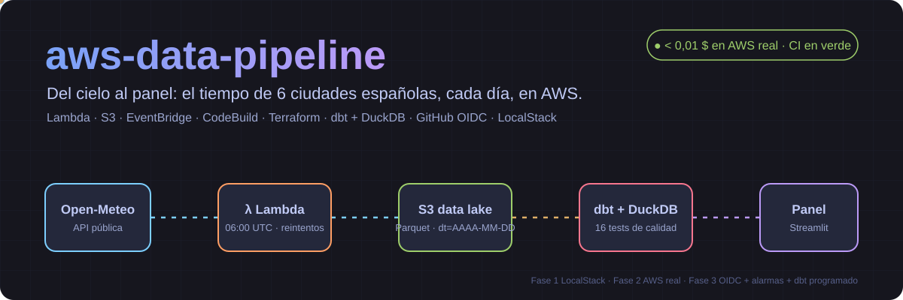
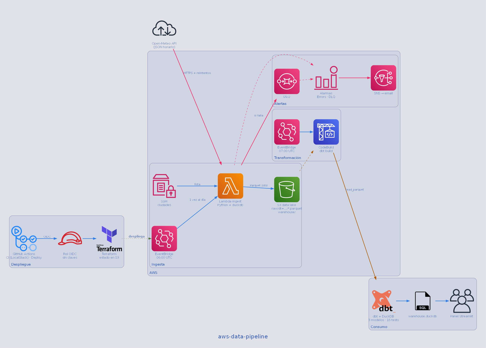
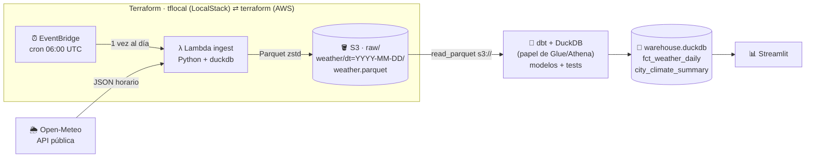
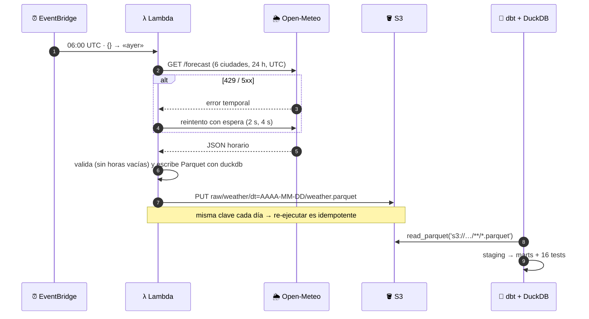
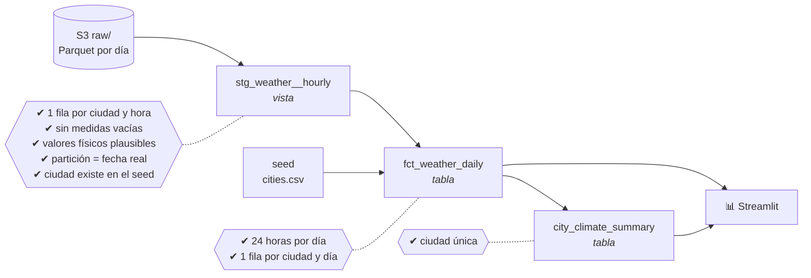
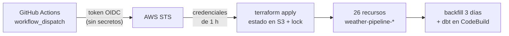
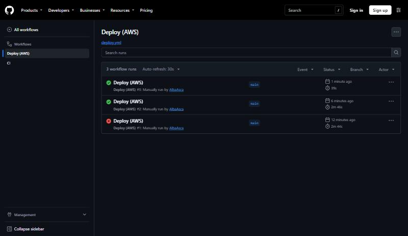
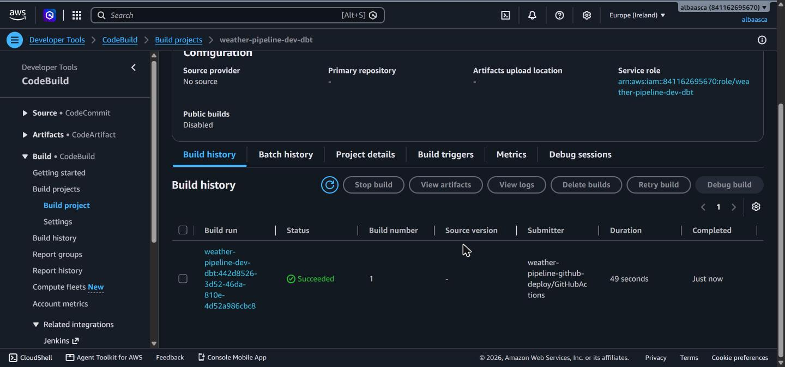
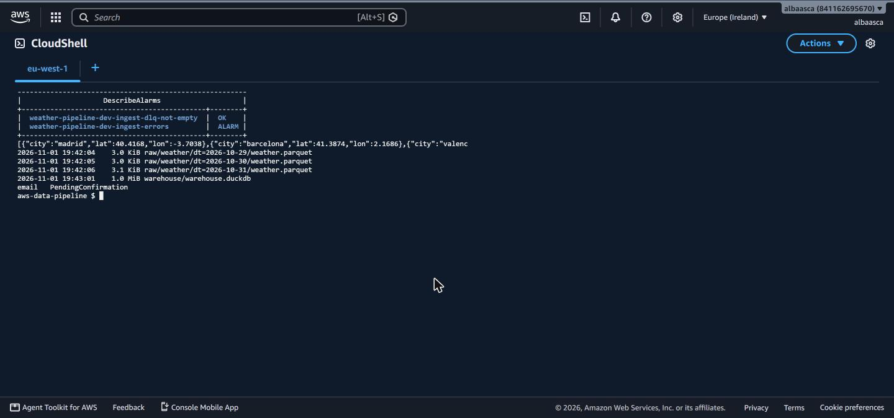

<p align="center">
  
</p>

<p align="center">
  <a href="https://github.com/AlbaAsca/aws-data-pipeline/actions/workflows/ci.yml"></a>
  
  
  
  
  
  
</p>

<p align="center">
  <b>Un pipeline de datos de punta a punta, como en una empresa, por menos de un céntimo.</b><br>
  Construido en <a href="https://www.localstack.cloud/">LocalStack</a> a coste 0, probado en una cuenta real de AWS y destruido después.
</p>

<p align="center">
  
</p>

| ☁️ Coste real en AWS | ✅ Calidad | 🛡️ Operación | 🔁 Reproducible |
|:---:|:---:|:---:|:---:|
| **< 0,01 $** en 2 despliegues reales | **16 tests** de dbt + **14** de pytest | Reintentos, DLQ y alarmas por email | **`make all`** en LocalStack, igual en el CI |

<p align="center">
  <a href="#arquitectura">Arquitectura</a> ·
  <a href="#cómo-ejecutarlo">Ejecutarlo en 2 comandos</a> ·
  <a href="#decisiones-y-su-porqué">Decisiones</a> ·
  <a href="#cuánto-costaría-en-aws">Costes</a> ·
  <a href="#fase-2-despliegue-real-en-aws">AWS real</a> ·
  <a href="#fase-3-operarlo-como-en-producción">Producción</a>
</p>

Cada día una Lambda descarga el tiempo horario de seis ciudades españolas, lo guarda en S3 como
Parquet particionado por fecha, dbt + DuckDB lo transforma y comprueba su calidad, y un panel en
Streamlit lo enseña.

## El problema

Quería un proyecto de ingeniería de datos que se pareciese a lo que se hace en una empresa
—ingesta programada, data lake, transformaciones versionadas, tests de calidad, infraestructura
como código y CI— pero sin las dos trampas habituales de los proyectos personales en la nube:

1. **La factura.** Es muy fácil dejarse un NAT Gateway o un cluster encendido y pagar 30 $ al
   mes por un proyecto que procesa 150 filas al día.
2. **El «funciona en mi cuenta».** Si para probarlo hace falta una cuenta de AWS, casi nadie lo
   prueba.

La solución: el mismo código y los mismos `.tf` corren en LocalStack (gratis, en local y en el
CI) y en AWS real cambiando solo el *endpoint*.

**Los datos** vienen de [Open-Meteo](https://open-meteo.com/): abiertos, gratuitos, sin clave
de API y con histórico, lo que permite rellenar días pasados (*backfill*). AEMET OpenData
también es gratis, pero exige pedir una clave, y eso lo haría menos reproducible para quien
clone el repo.

## Arquitectura



<sub>Generado como código con [`diagrams`](https://diagrams.mingrammer.com/): `python scripts/make_architecture.py`.
Debajo, la misma arquitectura en Mermaid, que GitHub dibuja directamente.</sub>



| Capa | En AWS | En este repo (fase 1) |
|---|---|---|
| Programación | EventBridge (regla `cron`) | EventBridge en LocalStack · `make ingest` para *backfill* |
| Ingesta | Lambda Python 3.12 | La misma Lambda, desplegada en LocalStack |
| Almacenamiento | S3, Parquet particionado `dt=` (estilo Hive) | S3 de LocalStack |
| Transformación y consulta | Athena / Glue | dbt-duckdb leyendo `s3://` directamente |
| Calidad de datos | Glue Data Quality / dbt | 16 tests de dbt |
| Visualización | QuickSight | Streamlit |
| Infraestructura | Terraform | Terraform vía `tflocal` |

### Un día en la vida del pipeline



## Cómo ejecutarlo

Necesitas Python 3.12, Docker y Terraform ≥ 1.6.

```bash
python -m venv .venv && source .venv/bin/activate   # Windows: .venv\Scripts\activate
pip install -r requirements-dev.txt

make all          # LocalStack + Terraform + 30 días de ingesta + dbt build
make dashboard    # http://localhost:8501
```


`make all` es la suma de cuatro pasos que puedes lanzar sueltos:

| Comando | Qué hace |
|---|---|
| `make up` | Arranca LocalStack (`docker compose`) |
| `make deploy` | Empaqueta la Lambda y crea S3 + Lambda + EventBridge con `tflocal apply` |
| `make ingest DAYS=30` | Invoca la Lambda una vez por cada uno de los últimos 30 días |
| `make transform` | `dbt build` contra el Parquet de S3: modelos y tests de calidad |

**¿Sin Docker?** `make local` ejecuta la misma lógica de ingesta escribiendo en `data/raw/` y
luego dbt sobre esos ficheros; útil para trabajar en los modelos sin levantar nada.

**Tests:** `make test` (ruff + pytest con [moto](https://github.com/getmoto/moto) simulando S3).


## Permisos y limpieza

**Qué necesitas en AWS:** una única vez, permisos de administración para aplicar
`infra/bootstrap` (proveedor OIDC de GitHub, rol de despliegue y bucket de estado). A partir de
ahí despliega el CI con ese rol, que solo puede tocar recursos con prefijo `weather-pipeline-*`.
En LocalStack no hace falta nada: acepta cualquier credencial.

**Qué permisos tiene el pipeline una vez desplegado:**

| Quién | Puede | No puede |
|---|---|---|
| Lambda de ingesta | `PutObject` en `raw/`, leer su parámetro SSM, enviar a su DLQ, escribir sus logs | Leer o borrar datos, tocar otros buckets |
| CodeBuild (dbt) | Leer `raw/`, escribir solo en `warehouse/`, escribir sus logs | Modificar los datos crudos |
| Rol de GitHub (OIDC) | Gestionar recursos `weather-pipeline-*` y el estado de Terraform | Nada fuera del proyecto; solo lo asume este repo desde el entorno `aws` |

**Cómo dejarlo todo como estaba:**

```bash
make down                                     # LocalStack: para el contenedor y lo borra todo
gh workflow run deploy.yml -f action=destroy  # AWS: borra los 26 recursos (el bucket incluido)
terraform -chdir=infra/bootstrap destroy      # opcional: rol OIDC y bucket de estado (cuestan 0 $)
```

## Qué hay dentro

```
src/ingest/handler.py     Lambda: Open-Meteo -> Parquet -> S3 (idempotente por día)
infra/terraform/          S3, Lambda, EventBridge, SSM, DLQ + alarmas + SNS, dbt en CodeBuild
infra/bootstrap/          Una vez: rol OIDC para GitHub y bucket de estado de Terraform
transform/                Proyecto dbt: staging (vista) -> marts (tablas) + tests
dashboard/                Streamlit + gráficas mplcyberpunk
scripts/                  build_lambda, backfill, run_local, make_charts, make_architecture
.github/workflows/ci.yml  Lint, tests, dbt, terraform validate y el pipeline entero en LocalStack
.github/workflows/deploy.yml  Despliegue manual a AWS por OIDC (plan / apply / destroy)
```

**Calidad de datos.** dbt comprueba en cada ejecución que no hay duplicados por ciudad y hora,
que cada día tiene sus 24 horas, que no faltan medidas, que los valores son físicamente
plausibles (temperatura entre -25 y 50 °C, humedad entre 0 y 100 %…), que cada fichero
`dt=YYYY-MM-DD` solo contiene horas de ese día y que todas las ciudades existen en la tabla
maestra.

Estos tests ya han cazado un fallo real: la API de previsión de Open-Meteo solo guarda unas
semanas de pasado y, más atrás, devuelve `null` sin dar error. El test
`assert_no_missing_measurements` lo detectó en un *backfill* de 60 días; ahora la Lambda usa
la API de archivo para fechas antiguas y se niega a escribir un día incompleto.

### Linaje de los datos y qué protege cada test



## Decisiones y su porqué

- **Lambda y no Glue para la ingesta.** Son 144 filas al día. Un job de Glue tarda en arrancar
  más de lo que tarda la Lambda en terminar, y se factura por DPU-hora.
- **DuckDB dentro de la Lambda para escribir Parquet.** Lo habitual es añadir la capa de
  *AWS SDK for pandas*, pero esa capa no existe en LocalStack Community. `duckdb` cabe en un zip
  de unos 20 MB, escribe Parquet sin pandas ni pyarrow, y es el mismo motor que usa la
  transformación.
- **Parquet particionado por fecha (`dt=`), en UTC.** Las particiones estilo Hive las entienden
  DuckDB, Athena y Glue sin configuración. Guardar en UTC evita los días de 23 o 25 horas del
  cambio de hora, que romperían el test de «24 horas por día».
- **Idempotencia.** Cada día se escribe siempre en la misma clave: repetir una ingesta (o un
  *backfill*) sobrescribe en lugar de duplicar. Aun así, el modelo de staging deduplica por
  si acaso, quedándose con la carga más reciente.
- **dbt + DuckDB en el papel de Athena.** El SQL de los modelos es casi el mismo que se
  escribiría en Athena, y DuckDB lee `s3://` igual de LocalStack que de AWS. En AWS real se
  puede mantener así o pasar a `dbt-athena`.
- **Mínimo privilegio.** La Lambda solo puede hacer `PutObject` bajo `raw/` y escribir sus
  propios logs. El bucket bloquea el acceso público y cifra con SSE-S3 (gratis; SSE-KMS
  cobra por petición).
- **Logs con caducidad (14 días).** Sin `retention_in_days`, CloudWatch guarda los logs para
  siempre y se acaban pagando.
- **Lambda fuera de una VPC.** Solo habla con una API pública y con S3, así que no necesita
  VPC… ni el NAT Gateway que vendría con ella.
- **LocalStack fijado en la versión 4.14.0.** Desde 2026 las imágenes nuevas piden token de
  cuenta; fijar la versión mantiene el proyecto reproducible sin registrarse en ningún sitio.

## ¿Cuánto costaría en AWS?

Estimación mensual con el volumen real del proyecto (1 invocación diaria de ~5 s con 512 MB,
~10 KB de Parquet al día), con precios públicos de referencia:

| Servicio | Uso al mes | Coste aprox. |
|---|---|---|
| Lambda | 30 invocaciones · ~75 GB-s | 0 $ (capa gratuita permanente: 1 M peticiones y 400 000 GB-s) |
| S3 | < 1 MB almacenado · 30 PUT | < 0,01 $ |
| EventBridge (regla programada) | 30 eventos | 0 $ |
| CloudWatch Logs | < 1 MB | 0 $ |
| CodeBuild (dbt diario) | ~1 min/día en `general1.small` | 0 $ (100 min/mes gratis) |
| CloudWatch Alarms, SNS, SQS, SSM | 2 alarmas, avisos por email, DLQ casi vacía, 1 parámetro estándar | 0 $ (capa gratuita permanente) |
| Athena (opcional, fase 2) | consultas sobre < 1 MB | ~0 $ (5 $/TB escaneado, mínimo 10 MB por consulta) |
| **Total** | | **< 0,05 $/mes** |

### Lo que se evita a propósito (porque es caro para este volumen)

| Servicio | Por qué no | Orden de coste |
|---|---|---|
| **NAT Gateway** | Solo haría falta si la Lambda estuviese en una VPC privada | ~33 $/mes encendido + datos |
| **AWS Glue** (jobs y crawlers) | Arranque lento y facturación por DPU-hora para 144 filas | 0,44 $/DPU-hora, crawlers con mínimo de 10 min |
| **RDS** | Una base de datos encendida 24/7 para datos que caben en un fichero | ~12–15 $/mes la instancia más pequeña |
| **QuickSight** | Licencia por usuario para un panel personal | decenas de $/usuario/mes |
| **MWAA** (Airflow gestionado) | Orquestar una sola tarea diaria | ~350 $/mes el entorno mínimo |

> Los precios cambian y dependen de la región. La región por defecto es `eu-south-2` (España),
> pero hay que activarla a mano en la cuenta; el despliegue real se hizo en `eu-west-1` (Irlanda).
> Antes de desplegar, conviene revisarlos en la
> [calculadora de AWS](https://calculator.aws/) y confirmar las condiciones de la capa
> gratuita, que cambiaron en julio de 2025.

## Fase 2: despliegue real en AWS

El 1 de noviembre de 2026 desplegué el pipeline en una cuenta real de AWS durante una
hora, lo ejecuté de punta a punta y lo destruí. **Mismos `.tf`, mismo código:** lo único que
cambió fue usar `terraform` en lugar de `tflocal` y apuntar DuckDB al S3 real.

### 1 · Primero, el freno de mano: un presupuesto

Antes de crear nada, un presupuesto mensual de 10 $ con avisos por email al 85 % y 100 % del
gasto real y al 100 % del previsto. AWS Budgets es gratuito.


### 2 · Despliegue desde CloudShell

Sin instalar nada ni guardar claves en el portátil: [AWS CloudShell](https://aws.amazon.com/cloudshell/)
ya trae credenciales temporales de la sesión. Instalé Terraform en `/tmp` (el *home* de CloudShell
solo tiene 1 GB y el *provider* de AWS ocupa ~700 MB: el primer `init` falló por eso) y
desplegué en `eu-west-1`:

```bash
python scripts/build_lambda.py
export TF_DATA_DIR=/tmp/tfdata                 # providers fuera del home de 1 GB
terraform -chdir=infra/terraform plan -var region=eu-west-1 -out=tfplan   # 11 recursos
terraform -chdir=infra/terraform apply tfplan
```


### 3 · Ingesta y transformación contra S3 real

```bash
python scripts/backfill.py --days 7
eval $(aws configure export-credentials --format env)   # DuckDB necesita las credenciales en variables
S3_ENDPOINT=s3.eu-west-1.amazonaws.com S3_USE_SSL=true S3_URL_STYLE=vhost RAW_GLOB=$(terraform -chdir=infra/terraform output -raw raw_glob)   dbt build --target lake --profiles-dir transform
```

Siete particiones `dt=` en el bucket y los 20 nodos de dbt (3 modelos, 1 *seed*, 16 tests) en verde:


### 4 · Lo que la nube real enseñó (y LocalStack no)

- **La API externa falla.** La primera invocación recibió un `HTTP 503` de Open-Meteo: se ve como
  el error en las métricas de la Lambda. En LocalStack nunca pasó. Ahora `fetch()` reintenta
  con espera creciente ante 429/5xx y no reintenta los 4xx (con tests).
- **Rendimiento:** ~1 s de media por invocación (máx. 2,8 s en frío), muy por debajo del
  *timeout* de 60 s y del 1 % de la capa gratuita de Lambda.
- **Límites del entorno:** el 1 GB de CloudShell no da para el *provider* de Terraform.


### 5 · `terraform destroy`


11 recursos destruidos; `aws s3 ls` y `aws lambda list-functions` ya no muestran nada del
proyecto. El presupuesto se queda como red de seguridad.

### Coste real

| Concepto | Uso | Coste |
|---|---|---|
| Lambda | 8 invocaciones · ~8 GB-s | 0 $ (capa gratuita permanente) |
| S3 | 7 objetos de ~10 KB, ~50 peticiones | < 0,01 $ |
| CloudShell, EventBridge, CloudWatch, Budgets | — | 0 $ |

<!-- Captura de la factura: AWS tarda ~24 h en reflejar el gasto; se añadirá aquí. -->

La prueba de la fase 2 se hizo con el usuario *root* desde CloudShell. La fase 3 lo corrige.

## Fase 3: operarlo como en producción

Tras la fase 2 quedaron anotadas cinco carencias. Están resueltas y probadas en AWS real el
mismo 1 de noviembre de 2026, desplegando **desde GitHub Actions, sin claves**:

| Antes | Ahora | Dónde |
|---|---|---|
| Despliegue a mano con *root* | Workflow `Deploy (AWS)` (plan / apply / destroy) que asume un rol por **OIDC**, limitado a `weather-pipeline-*` y al entorno `aws` | `.github/workflows/deploy.yml`, `infra/bootstrap/` |
| Estado de Terraform en local | **Backend S3** con versionado y bloqueo nativo (`use_lockfile`), sin DynamoDB | `infra/bootstrap/` |
| Si la Lambda falla, solo queda en los logs | **2 reintentos asíncronos → DLQ (SQS)**, alarmas de CloudWatch sobre `Errors` y la DLQ, aviso por **SNS** al email | `infra/terraform/monitoring.tf` |
| dbt solo en un portátil o en el CI | **dbt diario en CodeBuild** (07:00 UTC): clona el repo, `dbt build` contra S3 y deja `warehouse.duckdb` en `warehouse/` | `infra/terraform/dbt_schedule.tf` |
| 6 ciudades fijas en el código | **Parámetro SSM** gestionado por Terraform; un test verifica que coincide con el *seed* de dbt | `var.cities`, `handler.load_cities()` |



**Resultado en la cuenta real:** `Apply complete! Resources: 26 added`, 3 días ingeridos,
dbt en CodeBuild `SUCCEEDED` en 49 s y `Destroy complete! Resources: 26 destroyed`.





**Lo que enseñó esta vez la nube real:**

- **GitHub ya no usa `repo:owner/name` en el token OIDC.** Los repos nuevos llevan sujetos
  inmutables (`repo:AlbaAsca@<id>/aws-data-pipeline@<id>:environment:aws`) y el primer
  despliegue falló con `Not authorized to perform sts:AssumeRoleWithWebIdentity`. La política
  de confianza acepta ahora los dos formatos.
- **La alarma funcionó sin quererlo.** Saltó nada más crearse: las métricas de Lambda se guardan
  por nombre de función y la ventana de 1 h incluía el `503` real de la fase 2. Justo lo que debe
  hacer.
- **El *home* de CloudShell (1 GB) no da para Terraform**: `TF_DATA_DIR=/tmp/...`.

**Cómo usarlo en tu cuenta:**

```bash
terraform -chdir=infra/bootstrap init && terraform -chdir=infra/bootstrap apply   # una vez, como admin
gh variable set AWS_ROLE_ARN    -b "$(terraform -chdir=infra/bootstrap output -raw deploy_role_arn)"
gh variable set TF_STATE_BUCKET -b "$(terraform -chdir=infra/bootstrap output -raw state_bucket)"
gh variable set AWS_REGION -b eu-west-1 && gh variable set ALERT_EMAIL -b tu@email.com
gh workflow run deploy.yml -f action=apply -f backfill_days=3
gh workflow run deploy.yml -f action=destroy
```

## Limitaciones y siguientes pasos

| Hoy | Siguiente paso | Por qué |
|---|---|---|
| `warehouse.duckdb` como fichero en S3 | Tablas Iceberg en S3 Tables, consultables desde Athena | Consultas concurrentes y SQL desde cualquier herramienta |
| El panel de Streamlit corre en local | Descargar el `warehouse.duckdb` de S3 o publicarlo en Streamlit Community Cloud | Que el panel esté siempre al día sin ejecutar nada |
| CodeBuild con la imagen estándar sobre Amazon Linux 2 | Imagen de Amazon Linux 2023 | AWS recomienda migrar el *host* |
| El entorno `aws` de GitHub no exige aprobación | Revisores obligatorios en el entorno | Que nadie despliegue sin un segundo par de ojos |

## Licencia

MIT. Datos meteorológicos de [Open-Meteo](https://open-meteo.com/) (CC BY 4.0).
